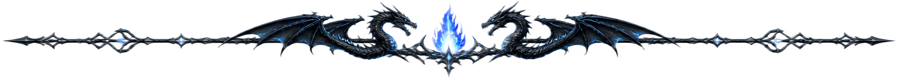
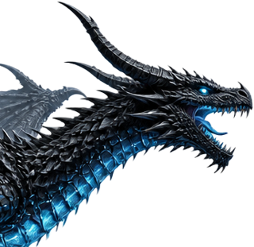
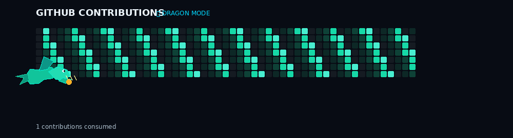

<div align="center">
  

<!-- ────────────────────────────────  TITLE  ──────────────────────────────── -->


**`SOFTWARE DEVELOPER`** · **`QA-MINDED BUILDER`** · **`WEB & APP DEVELOPER`** · **`TECH EXPLORER`**

<br />

> *“Code is just a tool… the real magic is what you build with it.”*

<br />

[](https://www.mostafa-taher.duckdns.org)
[](https://github.com/Mostafa-Taher-git)
[](https://www.linkedin.com/in/mostafa-taher-ahmed-59b60b318/)

`BUILD` ◆ `LEARN` ◆ `CREATE` ◆ `SHARE`


</div>

##  &nbsp;THE RIDER

I'm **Mostafa Taher**, a Computer & Artificial Intelligence graduate from **MTI University (2025)**, building practical software across development, testing, systems and the web.

I work where **software engineering meets problem solving**: shape an idea, turn it into a working product, test it, harden it, and learn from every failure along the way. Full-stack development with a **QA background** — I build it, then I make sure it doesn't fall apart.

Alongside code I'm a **Mechatronics Engineer & Instructor (part-time) at EDU-X**, training students in robotics, supporting R&D projects and coaching competition teams.

```text
◆ CURRENT FLIGHT PATH
├── 💻  Software Development
├── 🧪  Software Testing & QA
├── 🌐  Web Development
├── 🖥️  IT & Systems
├── 🤖  AI & Automation
├── 🎮  Game Development
└── 🦾  Mechatronics & Robotics Teaching
```

> **Philosophy** — Understand the problem first. Build the solution second. Polish it until it feels right.

<div align="center"></div>

##  &nbsp;THE FORGE

<table>
<tr>
<td width="50%" valign="top">

### 🖥️ &nbsp;Applications
Desktop, web and mobile applications designed around real problems and real workflows.

</td>
<td width="50%" valign="top">

### 🧪 &nbsp;Quality & Testing
Manual testing, API testing, debugging and quality-focused development.

</td>
</tr>
<tr>
<td width="50%" valign="top">

### 🐧 &nbsp;Systems & Linux
Linux, system architecture, desktop environments and operating-system development.

</td>
<td width="50%" valign="top">

### 🤖 &nbsp;AI & Automation
AI-powered workflows, tools and automation that make software genuinely more useful.

</td>
</tr>
</table>

<div align="center"></div>

##  &nbsp;DRAGONS I HAVE RAISED

<table>
<tr>
<td width="50%" valign="top">

### 💈 Roby Barber
**Arabic-first Windows desktop app — a barber shop, end to end.**
Queue, POS checkout with thermal receipts, payroll with commission/tips/advances, inventory with stock alerts, customer loyalty and WhatsApp integration. Fully offline: no server, no subscriptions. A custom Electron-run **226-check** smoke suite gates every release against real SQLite; **RSA-2048** machine-bound offline licensing with encrypted keys, clock-rollback detection and transfer protection; incremental backups every 10 minutes and on exit with one-click restore.

`Electron` `SQLite` `Vanilla JS` `Offline Licensing` `Automated QA`

*Freelance client build · 10/2026 – Present · source not public*

</td>
<td width="50%" valign="top">

### 🌙 [Luna-Quest](https://github.com/Mostafa-Taher-git/Luna-Quest)
**A living Moon colony — three engines, one simulation.**
30 Earth days on the Shackleton rim, every resource tied to the second. One shared C# core drives Godot .NET, Godot GDScript and Unity: deterministic one-second step, driveable crew rover under 1.62 m/s² lunar gravity, real CC0 / Poly Haven / NASA surface art. Guarded by 426 simulation checks, a 659-check headless self-test and a 238-check scene audit. English and Arabic.

`C#` `GDScript` `Godot 4.7` `Unity 6.3` `Deterministic Sim` `QA`

</td>
</tr>
<tr>
<td width="50%" valign="top">

###  [Mkindayzir](https://github.com/Mostafa-Taher-git/Mkindayzir)
**Self-hosted, local-first "Work OS".**
Project management, visual task boards, a knowledge vault and AI assistance in one independently deployable app. Async FastAPI + SQLAlchemy 2.0 + Alembic on PostgreSQL; session auth with AES-256-GCM encryption for stored API keys; React/Vite/TanStack Query/Zustand SPA served by a single FastAPI process in Docker.

`FastAPI` `SQLAlchemy 2.0` `PostgreSQL` `React` `Docker` `AES-256-GCM`

</td>
<td width="50%" valign="top">

### [LittleTech](https://github.com/Mostafa-Taher-git/LittleTech)
**Gamified troubleshooting learning platform, built with Flutter.**
14 domains and 400+ procedurally generated levels driven by a custom expert-system rule engine mapping ~200 real problem keywords to step-by-step diagnostics. Boss battles, points/streak/achievements and cosmetics, all earned through play. 100% offline Isar with encrypted multi-user isolation, state via Cubit.

`Flutter` `Dart` `Cubit` `Isar` `Rule Engine`

</td>
</tr>
<tr>
<td width="50%" valign="top">

###  [Greeneek](https://github.com/Mostafa-Taher-git/Greeneek)
**Open-source agent harness (`gnk`).**
Built on an everything-is-a-plugin architecture — tools, providers and behaviour all extend the same core. MIT licensed.

`TypeScript` `Plugins` `Agent Harness` `Open Source`

</td>
<td width="50%" valign="top">

### 🎮 Tetris — C++
A **Tetris clone written in C++ from scratch** — game loop, block rotation, collision, line clearing and score tracking, with no engine underneath.

`C++` `Game Development`

*Completed 09/2025 · source not pushed yet*

</td>
</tr>
<tr>
<td colspan="2" valign="top">

### 🥚 The rest of the hoard
Every egg, hatchling and full-grown wyrm lives in the repositories — including the portfolio you are one click away from.

**[Browse all repositories →](https://github.com/Mostafa-Taher-git?tab=repositories)**

</td>
</tr>
</table>

<div align="center"></div>

##  &nbsp;THE ARSENAL

<div align="center">

**LANGUAGES**


**Framework**


**DATABASES**


**OS & TOOLS**


**GAME ENGINES**


**TESTING & ENGINEERING**


## THE DRAGON FEEDS



<br />

<a href="https://github.com/Mostafa-Taher-git">
  
</a>
<a href="https://github.com/Mostafa-Taher-git">  </a> <br /><br /> 


</div>

##  &nbsp;CAREER FOCUS

I'm building my career around roles that combine **software development, troubleshooting, quality assurance and critical thinking**.

`Software Development` · `QA / Software Testing` · `IT / Technical Support` · `Web Development` · `Game Development`

<div align="center">


## ENTER MY WORLD

**🌐 [www.mostafa-taher.duckdns.org](https://www.mostafa-taher.duckdns.org)**  :octocat: [github.com/Mostafa-Taher-git](https://github.com/Mostafa-Taher-git) 

<br />

### THE DRAGON CODE

> **Build. Learn. Create. Share.**
>
> **I love technology.**

<br />


**🤗 Thanks for visiting.**

</div>
